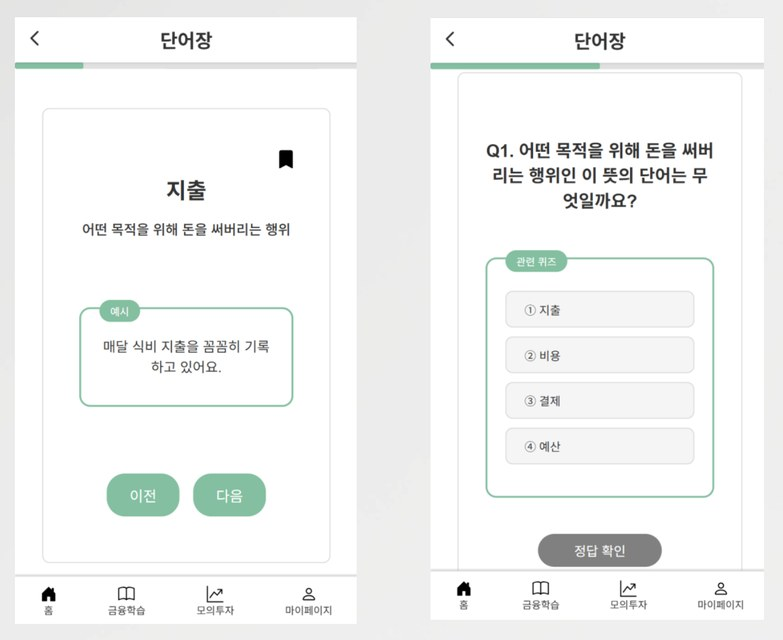
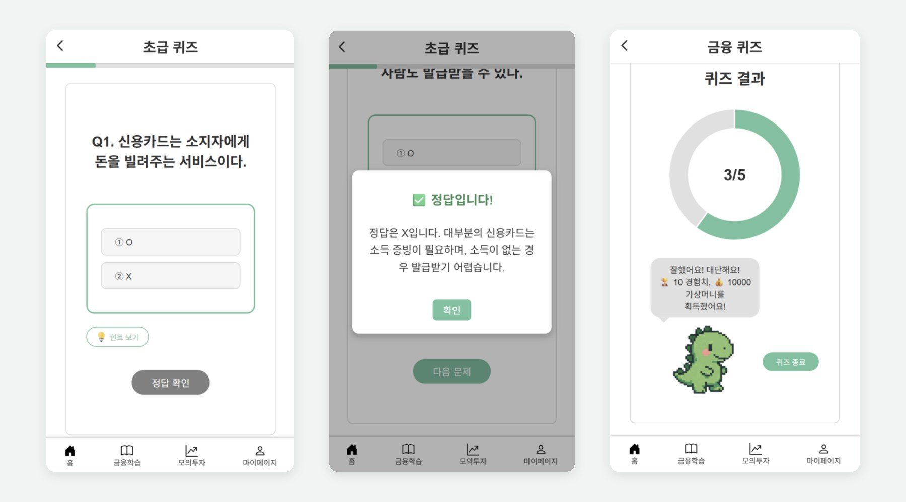
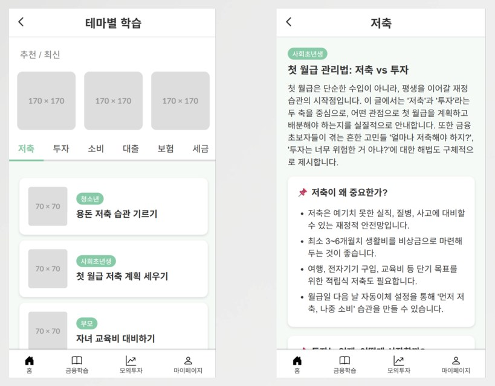
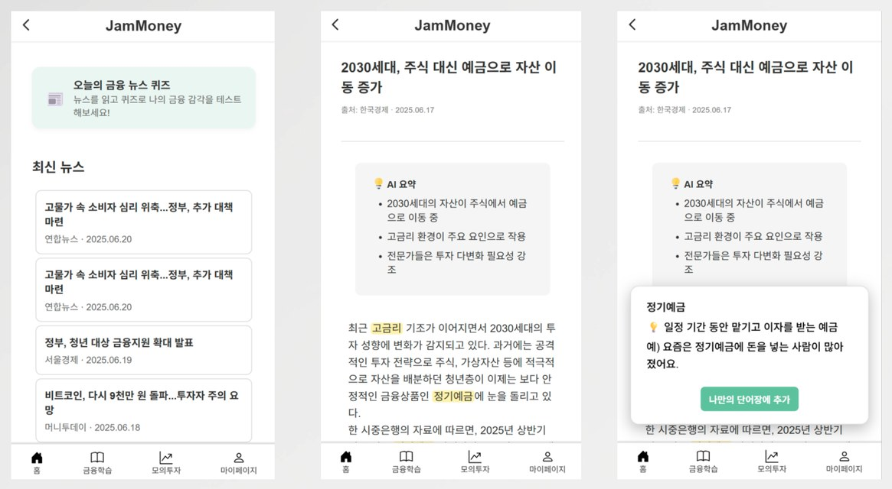
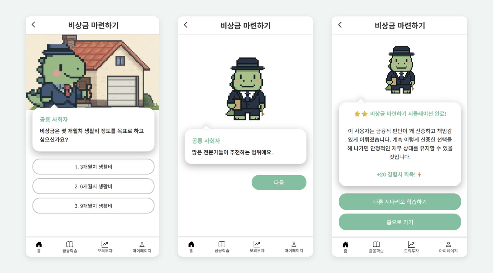
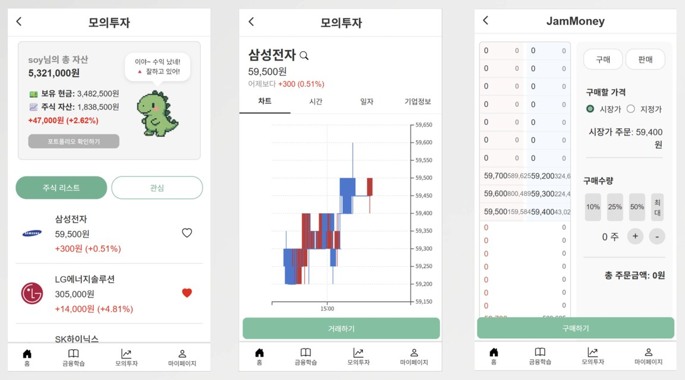

# JamMoney 잼머니 💸

> **잼(재미) + Money** — 캐릭터를 키우며 금융 용어·뉴스·시나리오·모의 투자로 배우는 게임형 금융 교육 서비스 (백엔드)

🔗 **서비스 바로가기:** https://jammoney.netlify.app/

정규 교육과정에서 실용적인 금융 교육을 받기 어렵고, 기존 금융 교육은 어렵고 딱딱해 흥미를 잃기 쉽습니다. 잼머니는 **게임 요소와 캐릭터 성장**을 결합해 금융 학습의 진입 장벽을 낮추고, **데일리 뉴스·상황 시나리오·모의 주식 투자**로 실제 금융 감각을 기를 수 있도록 만들었습니다.

## 📱 화면

| 금융 용어 단어장 | 금융 퀴즈 |
| :---: | :---: |
|  |  |
| **테마별 학습** | **데일리 뉴스** |
|  |  |
| **시나리오 학습** | **모의 주식 투자** |
|  |  |

## ✨ 주요 기능

- **금융 용어 단어장** — 카드 형식으로 용어를 익히고, 예문과 퀴즈로 복습하며, 즐겨찾기로 ‘나만의 단어장’에 저장합니다.
- **금융 상식 퀴즈** — 카테고리·난이도별 문제 5개를 GPT로 생성하고(OX·객관식), 힌트·해설과 오답노트를 제공합니다. 퀴즈를 마치면 캐릭터 경험치를 지급합니다.
- **테마별 학습** — 저축·투자·소비·대출·보험·세금 등 주제별, 연령·상황별 금융 콘텐츠를 제공합니다.
- **데일리 뉴스** — 경제 뉴스를 RSS로 수집해 AI가 핵심을 요약하고, 어려운 용어를 누르면 쉬운 풀이를 보여주며 관련 퀴즈를 제공합니다.
- **시나리오 학습** — “비상금 마련하기”처럼 실생활 상황에서 선택지를 고르고, 선택에 따른 피드백과 학습 완료 후 AI 총평을 받습니다.
- **모의 주식 투자** — 한국투자증권 Open API 기반 실시간 시세로 가상 투자합니다. 관심 종목, 캔들 차트·기업 정보, 시장가/지정가 주문, 포트폴리오를 지원하고 주문 체결은 롱 폴링으로 알려줍니다.

학습 활동으로 얻은 경험치로 캐릭터가 최대 10레벨까지 성장합니다. 로그인은 JWT로 처리하며, Refresh Token을 Redis에서 관리해 빠른 검증과 만료 처리, 기기별 로그아웃을 지원합니다([설계 문서](docs/refresh-token-rotation.md)).

## 🛠 기술 스택

| 영역 | 기술 |
| --- | --- |
| 언어·프레임워크 | Java 17, Spring Boot 3.4.5, Spring Web / WebFlux(WebClient), Validation |
| 데이터 | Spring Data JPA, MySQL, MapStruct, Lombok |
| 인증·세션 | Spring Security, JJWT 0.11.5, Redis (Refresh Token·세션) |
| 외부 연동 | OpenAI GPT API(퀴즈·시나리오·뉴스 요약), 한국투자증권 Open API(시세), AWS S3(캐릭터 이미지) |
| 수집·파싱 | Jsoup(뉴스 RSS 크롤링), Selenium, Apache POI |
| 테스트 | JUnit 5, Spring Boot Test, Testcontainers |
| 배포 | Docker, Docker Compose, GitHub Actions (CI/CD) |
| 프론트엔드 | HTML, CSS, JavaScript (별도 저장소) |
